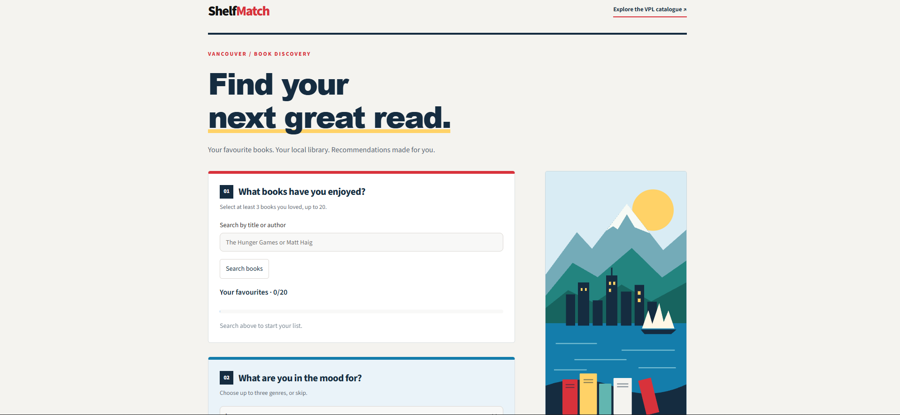
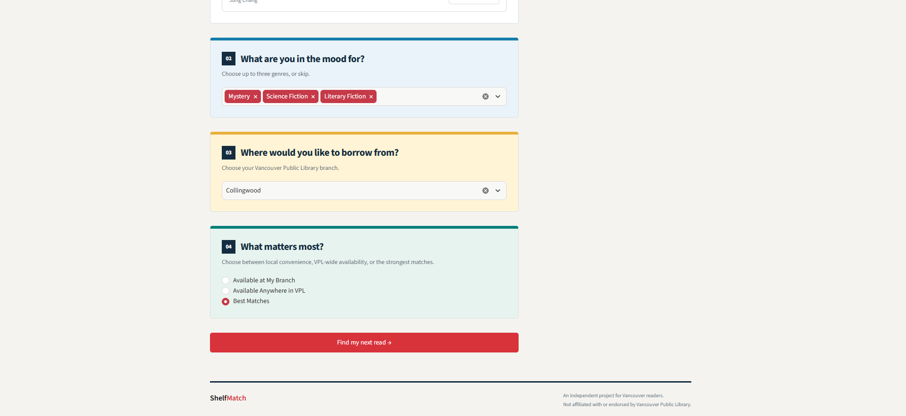
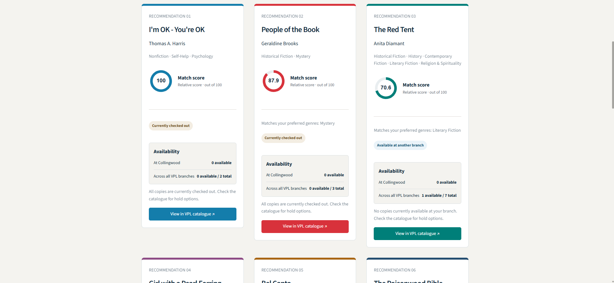
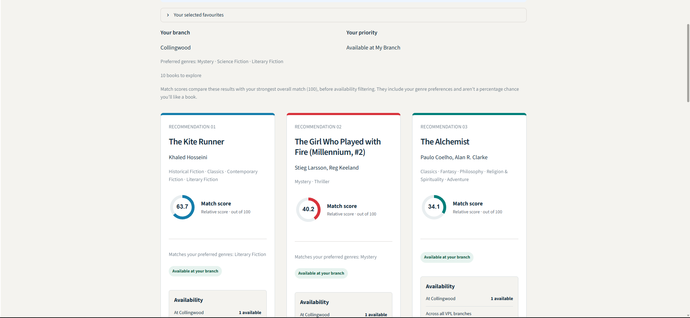

# ShelfMatch

**Your next great read, with availability in mind.**

ShelfMatch is a book recommendation prototype designed around Vancouver Public Library readers. It combines books you already enjoy, preferred genres, and branch-level availability to answer a practical question: **what should I read, and can I borrow it?**

Built individually by Cristian Batista at **HackCamp 2026**.

**[Watch the demo on YouTube →](https://youtu.be/OcHqqNH_5Zc)**

[](https://youtu.be/OcHqqNH_5Zc)

> **Prototype status:** recommendations use real historical Goodreads ratings and tags. All holdings and copy counts are simulated. ShelfMatch is an independent project, not an official VPL service; live catalogue and inventory API integration is a future goal.

## Why I built it

Choosing a book can take longer than it should. I have picked up books that sounded interesting, started reading, and lost interest. As someone motivated by numbers, I wanted recommendations grounded in patterns from other readers who enjoyed the same books as me.

The library setting adds another question: is the recommendation available where I want to borrow it? ShelfMatch combines personal relevance with that practical constraint in one workflow.

VPL already offers staff-curated reading suggestions, including [Books Just for You](https://www.vpl.ca/borrowing/what-do-i-read-next). ShelfMatch explores an automated, on-demand companion to that kind of personalized guidance, especially for someone already browsing at a branch.

The longer-term vision includes an approachable experience for seniors and other readers less comfortable with technology. A library computer or kiosk could let someone get a recommendation without needing a personal smartphone, independently or with staff assistance. Usability and accessibility testing with these readers is a planned next step.

## What it does

- Search by title or author and select **3–20 favourite books**.
- Optionally select **up to three genres**.
- Choose a VPL branch and a recommendation priority.
- Receive **up to 10 recommendations**, with at most one title per primary author.
- See a circular match-score indicator and numeric score out of 100 on each card.
- Compare simulated local availability, system-wide availability, and total system copies.
- Open a VPL catalogue search for a recommended title.

| Priority | Eligible recommendations |
| --- | --- |
| Available at My Branch | At least one simulated available copy at the selected branch |
| Available Anywhere in VPL | At least one simulated available copy across the system |
| Best Matches | Any title owned in the simulated collection, including fully checked-out titles |

Availability changes which books are eligible. It is not an extra popularity score or a prediction of when a book will be returned.

## Screenshots

### Choose your reading preferences

Select genres, a branch, and whether to prioritize availability or the strongest matches.



### Compare your best matches

Recommendation cards bring together relative match scores, genre matches, copy counts, and catalogue links. All inventory shown in these screenshots is simulated.

[](https://youtu.be/OcHqqNH_5Zc)

*Click the screenshot to watch the demo.*

### Find something available at your branch

Switching to **Available at My Branch** changes the results while retaining the same score reference. In this example, the first local match scores 63.7 rather than being rescaled to 100.



## How recommendations work

### 1. Item-based collaborative filtering

The model treats historical **4- and 5-star ratings as positive interactions**. Each book is represented by a sparse binary vector of readers who liked it. The vectors are L2-normalized, so their dot products give cosine similarity.

For each candidate, ShelfMatch averages its similarity to the selected favourites. It excludes the favourites themselves.

This measures overlap between books' audiences rather than similarity between their descriptions.

### 2. Genre-aware ranking

A curated alias map converts Goodreads shelf tags into selectable genres. The preprocessing pipeline:

- Joins tags through `goodreads_book_id` to the model's `book_id`.
- Uses the strongest tag count among aliases for each genre, avoiding duplicate evidence from synonyms.
- Normalizes genre evidence relative to the strongest mapped genre for that book.
- Removes weak labels and retains at most five genres per title.

The final relevance score is:

```text
base_score = mean cosine similarity to selected favourites
matched_weight = sum of weights for the user's selected genres
final_score = base_score × (1 + 0.25 × min(matched_weight, 1))
```

The genre boost is capped at **25%**. Genres influence the ranking without becoming a strict filter. A zero collaborative score remains zero. These are ranking scores, not probabilities that a reader will enjoy a book.

### 3. Availability and diversity

The backend applies the selected inventory constraint, ranks eligible books, then keeps at most one result per primary author until it reaches 10 results or runs out of positive scores. This encourages variety, although sequels to favourites can still appear.

### 4. Relative match scores

Each card displays a circular indicator and a numeric score out of 100. The backend returns both `recommendation_score` (the genre-adjusted relevance score) and `match_score` (the relative display score):

```text
reference_score = highest positive final_score among books not selected as favourites
match_score = 100 × final_score / reference_score
```

The reference is calculated **before all inventory and availability filtering**, including collection ownership. It therefore includes unseen books outside the simulated collection. Here, “unseen” means not selected as a favourite; the app does not know the reader's complete reading history.

With the same favourites and genres, a book keeps the same score when the branch or availability mode changes. The first displayed result can score below 100 if the strongest overall match is filtered out. Changing favourites or genres can change the reference and the scores.

A score of 80 means the book has 80% of the reference book's ranking score—not an 80% chance of enjoyment or a measured accuracy of 80%. The display rescales existing relevance scores; it does not change the ranking algorithm.

## Data and scale

The project uses [Goodbooks-10k](https://github.com/zygmuntz/goodbooks-10k), a historical Goodreads dataset released in 2017.

Measured from the supplied project files:

| Component | Size |
| --- | ---: |
| Book catalogue | 10,000 titles |
| Historical readers | 53,424 |
| Rating records | 5,976,479 |
| Positive interactions stored in the sparse model | 4,122,111 |
| Book–reader matrix | 10,000 × 53,424 |

SciPy sparse matrices store observed interactions without materializing the full dense book–reader matrix. Recommendation requests compare candidates only with the selected favourites. Cached loaders reuse the model and supporting tables within the running backend process.

### Data limitations

The 2017 snapshot does not represent current reader preferences or a current library catalogue. Books published after collection are absent, and titles around the collection date may have limited coverage. The dataset emphasizes popular books; historical Goodreads readers are not necessarily representative of VPL patrons.

## Simulated inventory

The simulator provides a reproducible environment for testing availability-aware recommendations. **Its parameters are modelling assumptions, not measured VPL operating statistics.**

The current generator uses:

- A fixed random seed of `42`.
- Guaranteed inclusion for the top popularity tier, approximately 20% of titles; other titles have inclusion probabilities ranging from 80% to 95%.
- **1–30 system-wide copies** per included title, using a nonlinear transformation of Goodreads rating counts:

```text
copies = round(1 + 29 × (ratings_count / maximum_ratings_count)^(2/3))
```

- A checkout probability increasing from 25% to 90% with popularity rank.
- Binomial sampling for available copies and weighted multinomial allocation across branches.

Available copies are assigned to one branch each. System totals are repeated on branch rows: sum `available_copies` across branches, but do not sum repeated `total_copies` or `vpl_available_copies` values.

The supplied inventory CSV and generator are not the same revision: the CSV contains 20 distinct branches, while the generator defines 21, including a zero-weight branch. Regenerate the CSV to use the documented generator settings consistently.

## Technology

| Tool | Role |
| --- | --- |
| Python | Application and data pipeline |
| Streamlit, HTML/CSS | Interactive interface and styling |
| pandas, NumPy | Cleaning, joins, ranking, and inventory simulation |
| SciPy | Sparse matrix storage and similarity calculations |
| scikit-learn | L2 normalization during model preparation |

No paid inference API or GPU is required by the recommendation implementation.

## Run locally

Use Python 3.10 or newer. Run commands from the project root. The layout below is expected by the supplied scripts; keep the original filenames when copying downloaded project files.

```text
app.py
backend.py
genre_config.py
.streamlit/config.toml
scripts/build_model.py
scripts/build_genres.py
scripts/generate_inventory.py
data/raw/books.csv
data/raw/ratings.csv
data/raw/tags.csv
data/raw/book_tags.csv
data/processed/
models/
```

Create and activate a virtual environment:

```bash
python -m venv .venv
```

Windows PowerShell:

```powershell
.venv\Scripts\Activate.ps1
```

macOS/Linux:

```bash
source .venv/bin/activate
```

Install dependencies and create output directories:

```bash
python -m pip install streamlit pandas numpy scipy scikit-learn
python -c "from pathlib import Path; Path('models').mkdir(exist_ok=True); Path('data/processed').mkdir(parents=True, exist_ok=True)"
```

Download `books.csv`, `ratings.csv`, `tags.csv`, and `book_tags.csv` from the [Goodbooks-10k repository](https://github.com/zygmuntz/goodbooks-10k) into `data/raw/`, then prepare the artifacts:

```bash
python scripts/build_model.py
python scripts/build_genres.py
python scripts/generate_inventory.py
python -m streamlit run app.py
```

If compatible model and processed data files are already present, rebuilding is optional. Restart the application after regenerating files to clear cached data. The current backend uses `DEMO_MODE = False`: recommendations are computed from the model, although inventory remains simulated.

These are dependency-based setup instructions, not a pinned, clean-environment reproducibility guarantee.

## Validation and next steps

A backend smoke check using The Hunger Games, Divergent, and The Maze Runner with Dystopian and Central Library returned 10 results in each priority mode against the supplied artifacts. Local availability changed the results. An additional check with 20 favourites returned 10 results and excluded all selected books. Shared results retained identical match scores across the three priority modes; in the sample profile, the top local result scored approximately 90.94 while the strongest overall match scored 100. This checks functionality, not recommendation quality; it does not constitute a browser or deployment test.

Recommendation quality is currently unmeasured: functional checks show that the pipeline runs, but do not establish whether readers will enjoy its suggestions. The 25% genre boost and other ranking choices have not yet been validated against held-out outcomes.

### Development roadmap

1. **Evaluate quality.** Compare Recall@K and NDCG@K against popularity and collaborative-only baselines, alongside catalogue coverage and author diversity. Follow with reader testing to assess usefulness and ease of choosing a book.
2. **Develop a richer hybrid model.** Explore book descriptions, themes, mood, language, length, reading pace preferences, and negative feedback where suitable data is available. Tune the balance between collaborative similarity, content, and diversity using validation results. Keep additional preferences optional, and retain complexity only when it improves measured outcomes.
3. **Build a reader feedback loop.** Let patrons optionally rate books after reading them and indicate whether recommendations suited their tastes. These are distinct signals: liking a book and finding a suggestion useful are not always the same. Use the feedback to evaluate and improve recommendations.
4. **Explore a VPL-specific ratings dataset.** With a library partnership, permission-based collection, and sufficient participation across titles, locally collected ratings could gradually reduce reliance on third-party Goodreads data. At scale, the system could potentially recommend primarily from its own readers' ratings. This is a future direction; the prototype does not collect patron ratings or borrowing histories.
5. **Test accessibility in the library.** Work with seniors and other readers less familiar with technology to improve text size, contrast, keyboard navigation, plain-language instructions, and the number of steps. Explore a library computer or kiosk with optional staff assistance. Accessibility has not yet been validated with users.
6. **Refresh data and integrate availability.** Add newer titles and a content-based fallback for sparsely rated books. Explore authorized VPL catalogue/inventory access, with work-to-edition/ISBN matching, refresh timestamps, and graceful handling of unavailable data.
7. **Improve reading controls.** Add preferences for sequels, previously read books, and discovery beyond familiar authors.

The current app does not authenticate library accounts, place holds, or predict wait times.

## Credits

Created individually by **Cristian Batista** for **HackCamp 2026**.

Dataset: **Goodbooks-10k**, by Zygmunt Zając, sourced from Goodreads. Consult the upstream repository for dataset attribution and licence terms. VPL names and catalogue links identify the intended use case and do not imply affiliation or endorsement.

*Built with AI assistance from GPT-6 Astra, Sol, and Luna.*
